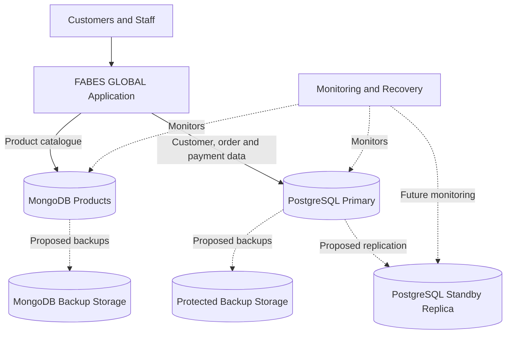

# FABES GLOBAL Distributed Database Architecture

**Status:** Proposed architecture. PostgreSQL and MongoDB have been implemented locally; replication, sharding, and automated backup infrastructure have not been deployed.

## Architecture Explanation

- **FABES GLOBAL Application:** The proposed application layer through which customers and staff access the system.
- **PostgreSQL Primary:** Stores relational data, including customers, orders, order items, payments, and deliveries.
- **MongoDB Products:** Stores flexible product catalogue documents and product attributes.
- **PostgreSQL Standby Replica:** A proposed secondary database to support availability and potentially serve read-only queries.
- **Protected Backup Storage:** A proposed location for recoverable database backups.
- **Monitoring and Recovery:** A proposed process for monitoring database health and responding to failures.

## Distribution Strategy

PostgreSQL and MongoDB separate relational transactions from flexible product catalogue data. A future PostgreSQL replica could improve availability and distribute read workloads. Sharding could be considered if the system grows beyond the capacity of a single database server.

**Important limitation:** The replica, sharding, backup infrastructure, and monitoring shown here are design proposals, not deployed components.
